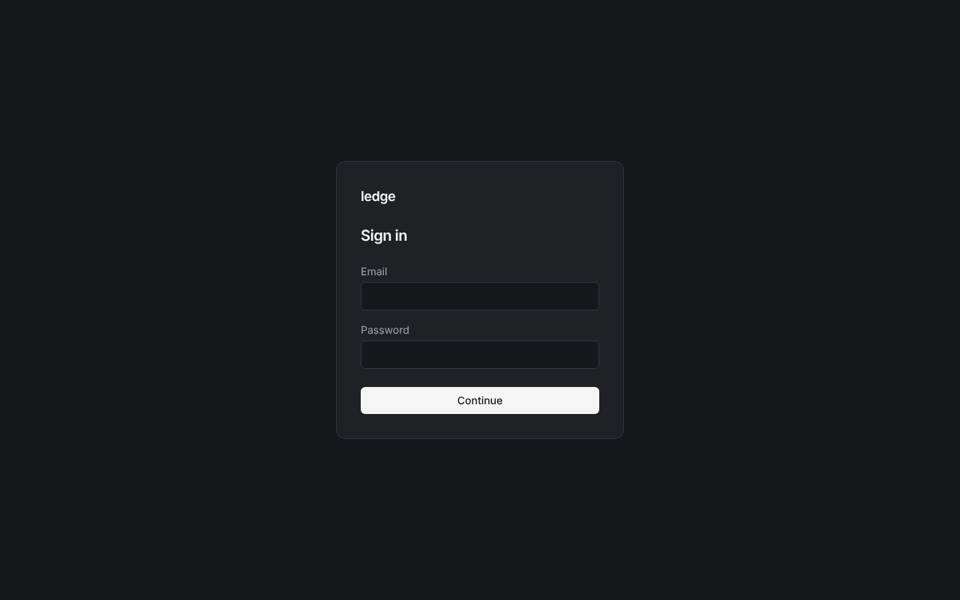
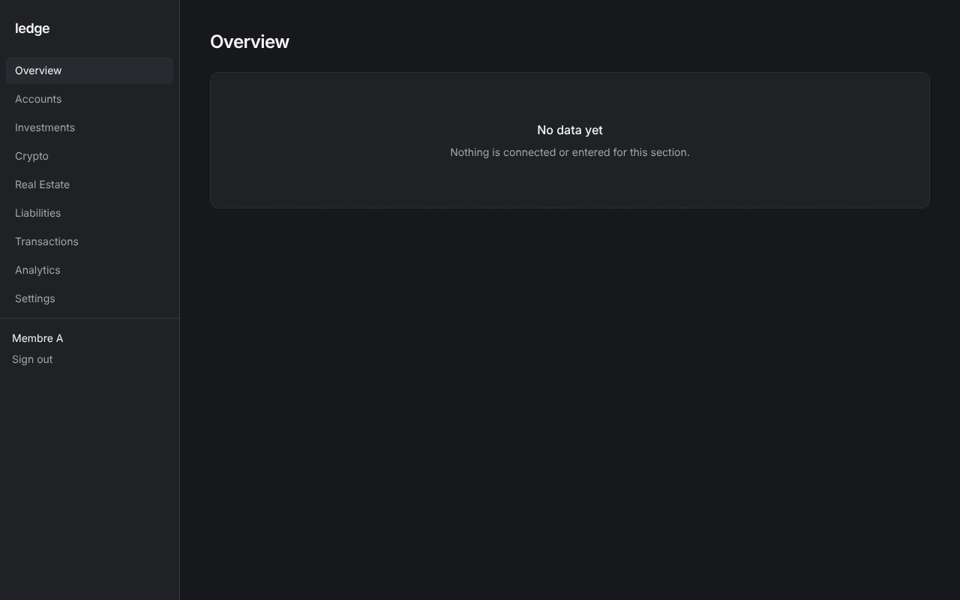
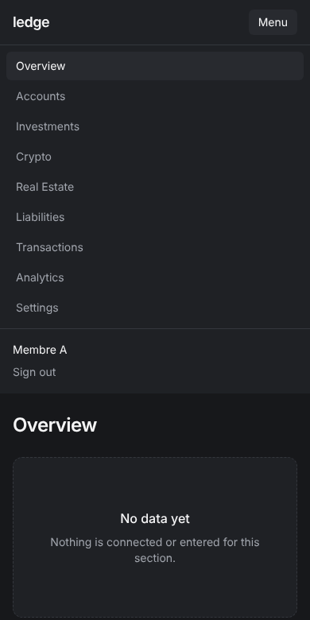

# Anàlisi de l'estat del projecte i del disseny

> 01/11/2026. Foto del repo a `main` (`f826c72`) més la branca `docs/charts-design`.
> Relacionat: [`DESIGN_CHANGES.md`](DESIGN_CHANGES.md) (què canviar del disseny) · [`MANUAL_SETUP.md`](MANUAL_SETUP.md) (què has de fer tu per veure la web) · [`../NEXT_STEPS.md`](../NEXT_STEPS.md) (full de ruta).

## 1. Resum

| Àmbit             | Estat                                                                                                                                     |
| ----------------- | ----------------------------------------------------------------------------------------------------------------------------------------- |
| Codi de la Fase 1 | Punts 0–7 fets i a `main`. Lint, test i build passen (9 tasques).                                                                         |
| Web               | Login → alta del TOTP → codis de recuperació → Overview buit. **Funciona de punta a punta** en local (provat avui amb un navegador real). |
| Gràfiques         | La lib `libs/web/charts` + G-1 **no és a `main`**: el PR #10 es va fusionar a una branca que ja estava fusionada (§3, T1).                |
| CI i desplegament | Només hi ha el workflow de gitleaks. Cap CI de lint/test/build ni Vercel (punts 8–9).                                                     |
| Integracions      | Spikes escrits, **cap executat**. Gates G1–G4 pendents.                                                                                   |
| Decisions         | D1, D2, D4, D5 pendents. D4 i D5 bloquegen el desplegament.                                                                               |
| Disseny           | Base sòbria i coherent, però amb problemes de contrast, focus, idioma i navegació (§4).                                                   |
| Documentació      | Completa però dispersa i amb dades desfasades. Centralitzada en aquest PR (§5).                                                           |

**En una frase:** el projecte té una base de seguretat sòlida, però avui ningú pot veure la web sense muntar-la en local, i el següent salt (dades reals) depèn de coses que has de fer tu (§6).

## 2. Què s'ha verificat avui

| Prova                                       | Resultat                                                                                                                          |
| ------------------------------------------- | --------------------------------------------------------------------------------------------------------------------------------- |
| `npm ci`                                    | OK                                                                                                                                |
| `npx nx run-many -t lint test build`        | OK, 9/9 tasques                                                                                                                   |
| `npx nx run api:test-integration`           | **No executat**: l'entorn no té el dimoni de Docker. Pendent que ho faci el CI (punt 8).                                          |
| `npx nx run api:migrate` contra Postgres 16 | OK (les 2 migracions s'apliquen)                                                                                                  |
| `create-user` amb la contrasenya per stdin  | OK                                                                                                                                |
| Flux complet al navegador (Playwright)      | OK: error genèric amb contrasenya dolenta, QR i clau manual, codi TOTP, 10 codis de recuperació i Overview amb el nom de l'usuari |

Captures de l'estat actual: [`design/captures/`](design/captures/).

| Login                                  | Overview                                     | Menú mòbil                                        |
| -------------------------------------- | -------------------------------------------- | ------------------------------------------------- |
|  |  |  |

## 3. Troballes del projecte (per prioritat)

| #   | Troballa                                                                                                                                                                                                                                  | Impacte                                                                          | Què fer                                                             |
| --- | ----------------------------------------------------------------------------------------------------------------------------------------------------------------------------------------------------------------------------------------- | -------------------------------------------------------------------------------- | ------------------------------------------------------------------- |
| T1  | **PR #10 (lib de gràfiques + G-1) fusionat a `docs/charts-design`**, no a `main`. Aquella branca ja s'havia fusionat amb el PR #9 quatre segons abans. Diferència: 45 fitxers (`libs/web/charts`, `net-worth.ts`, ruta `/dev/charts`…).   | El codi existeix però no és enlloc útil. `NEXT_STEPS` el dona per pendent.       | ✅ Resolt: PR #11 (`docs/charts-design → main`).                    |
| T2  | **Definition of Done de la Fase 1 no complerta**: no hi ha CI (punt 8) ni Vercel (punt 9).                                                                                                                                                | Cap PR comprova lint/test/build ni els tests d'integració. No hi ha URL pública. | Sessió de la Fase 1, punts 8–9 (prompt a `NEXT_STEPS.md` §3c).      |
| T3  | **L'API no té on viure.** La cookie és `SameSite=Strict` i `__Host-`: web i API han de compartir site. Sense domini (D4) ni VPS (D5), Vercel només pot servir la pantalla de login, que fallarà en fer login.                             | El DoD de la Fase 1 («login amb 2FA a Vercel») és impossible sense D4 i D5.      | Decidir D4 i D5 ([`MANUAL_SETUP.md`](MANUAL_SETUP.md) §3).          |
| T4  | **Gates G1–G4 sense executar.** Els spikes són a `main` des del 31/10.                                                                                                                                                                    | La Fase 3 (dades automàtiques) no pot començar.                                  | Executar els spikes ([`../spikes/README.md`](../spikes/README.md)). |
| T5  | **Documentació desfasada**: `NEXT_STEPS` deia que el PR #8 estava pendent (es va fusionar) i que G-1 estava per fer; `IMPLEMENTATION_PLAN` D3 proposava `household-wealth` (el repo és `ledge`) i el Pas previ B tenia el repo per crear. | Les sessions noves arrenquen amb context fals.                                   | Corregit en aquest PR.                                              |
| T6  | **Fase 2 no depèn de cap gate i no ha començat.** És la que dona les primeres xifres (entrada manual, hipoteca, patrimoni net).                                                                                                           | Mentre no hi sigui, la web és una pantalla buida.                                | Prioritzar-la just després del CI (§6).                             |
| T7  | **Pendents tècnics** ja coneguts: rotació de la clau mestra, rols de BD separats, reinici del 2FA, neteja de sessions, capçaleres de seguretat de l'API, build de Docker darrere d'un proxy TLS.                                          | Cap bloqueja el MVP. Les capçaleres (helmet) sí abans de producció.              | Llista a `NEXT_STEPS.md` §3c.                                       |

### Què està bé

- **Seguretat per defecte**: secrets en fitxers, TOTP obligatori, sessions revocables, CSRF en tres capes, aïllament de household amb 404 i filtre obligatori, xifratge amb AAD, gitleaks amb checksum. És més del que acostuma a tenir un projecte personal.
- **Tests on toca**: unitaris del xifratge, l'auth i l'aïllament; tests d'integració amb Postgres real.
- **Disciplina de PR i documentació**: cada punt té el seu PR i la seva entrada als documents.

## 4. Anàlisi del disseny

### 4.1 Què funciona

- Paleta fosca sòbria amb tokens (`canvas`, `surface`, `content`…) i semàntica clara: verd i vermell **només** per a guanys, pèrdues i alertes.
- Formularis amb `label`, `autocomplete` correcte (`username`, `current-password`, `one-time-code`) i errors amb `role="alert"`.
- Missatges d'error genèrics (no revelen si l'usuari existeix), i la contrasenya es buida del DOM després d'un error.
- Estat buit honest: cap xifra inventada.
- Sistema de gràfiques ben pensat a `docs/CHARTS.md` (paleta validada, accessibilitat, estats).

### 4.2 Problemes

Els valors de contrast s'han calculat amb la fórmula de WCAG 2.x.

| #    | Problema                                                                                                                                                                                                         | On                                 | Gravetat               |
| ---- | ---------------------------------------------------------------------------------------------------------------------------------------------------------------------------------------------------------------- | ---------------------------------- | ---------------------- |
| D-1  | **Contrast insuficient de `content-subtle`** (`#71757e`): 3,49:1 sobre `surface` i 3,11:1 sobre `surface-raised`. WCAG AA demana 4,5:1 per a text petit. S'usa en placeholders i ajudes (`t-text-xs`).           | `styles.css`, `totp-page.ts`       | Alta                   |
| D-2  | **Vores dels camps invisibles**: `line` (`#34373d`) fa 1,35:1 sobre `surface`. Un control necessita 3:1 (WCAG 1.4.11). El camp de text gairebé no es distingeix del fons.                                        | `INPUT_CLASS`                      | Alta                   |
| D-3  | **Focus del teclat feble**: els camps fan `focus:t-outline-none` i només canvien la vora a gris. Els enllaços del menú i els botons depenen de l'outline per defecte del navegador.                              | `auth-card.ts`, `shell.html`       | Alta                   |
| D-4  | **Idioma barrejat**: la UI és en anglès (`lang="en"`, «Sign in», «No data yet»), però les gràfiques formaten en `ca-ES` i diuen «Encara no hi ha dades». Els usuaris són catalanoparlants.                       | `index.html`, totes les pantalles  | Mitjana                |
| D-5  | **Inter no es carrega**: és al `font-family`, però cap fitxer la porta. Cada màquina veu una lletra diferent (Inter si la té instal·lada, si no la del sistema). Les xifres no tenen `tabular-nums` per defecte. | `tailwind.config.js`, `index.html` | Mitjana                |
| D-6  | **Navegació plana de 9 seccions**, sense icones ni grups. Totes porten a la mateixa pantalla buida, incloses les que no tindran dades fins a la Fase 3 o 4 (Transactions, Analytics).                            | `navigation.ts`, `shell.html`      | Mitjana                |
| D-7  | **Menú mòbil**: empeny el contingut cap avall en lloc de sobreposar-se, no es tanca amb Esc ni tocant fora, i el botó diu «Menu» sense icona.                                                                    | `shell.html`                       | Mitjana                |
| D-8  | **Sense context de household**: no es veu a quina household ets ni qui més hi ha. L'usuari i «Sign out» queden a mitja barra lateral, no ancorats a baix.                                                        | `shell.html`                       | Baixa                  |
| D-9  | **Estat buit genèric**: «No data yet / Nothing is connected» és igual a totes les seccions i no diu què falta ni quan hi haurà dades.                                                                            | `empty-section.ts`                 | Mitjana                |
| D-10 | **Cap espai per a l'origen de la dada**. `INTEGRATION_FEASIBILITY.md` exigeix que la UI etiqueti el que és manual o estimat (fons, hipoteca, immobles). No hi ha cap component per fer-ho.                       | —                                  | Alta (per a la Fase 2) |
| D-11 | **Codis de recuperació**: no hi ha botó de copiar ni confirmació explícita; «I have saved them» es pot prémer sense haver-los desat.                                                                             | `totp-setup-page.ts`               | Baixa                  |
| D-12 | **Sense escala tipogràfica** definida: cada pantalla tria la mida (`t-text-lg`, `t-text-xl`, `t-text-2xl`) sense regla. Marca i favicon per defecte (text «ledge» i la icona del generador).                     | global                             | Baixa                  |

Les solucions, amb referències HTML, són a [`DESIGN_CHANGES.md`](DESIGN_CHANGES.md).

## 5. Documentació

**Abans d'aquest PR:** 7 documents (≈1.600 línies). `NEXT_STEPS.md` (470 línies) barrejava estat, guies i prompts de sessions ja fetes; el `README.md` barrejava com arrencar amb detalls de seguretat; no hi havia cap índex.

**Canvis:**

- Índex únic a [`docs/README.md`](README.md): quin document mana per a cada cosa.
- Prompts de sessions ja fetes → [`docs/archive/SESSION_PROMPTS.md`](archive/SESSION_PROMPTS.md). `NEXT_STEPS.md` només té el que queda per fer.
- Estat corregit a `NEXT_STEPS.md`, `IMPLEMENTATION_PLAN.md` i `README.md` (T1, T5).
- Documents nous: aquesta anàlisi, [`DESIGN_CHANGES.md`](DESIGN_CHANGES.md) i [`MANUAL_SETUP.md`](MANUAL_SETUP.md).
- `CLAUDE.md` apunta a l'índex.

## 6. Ordre recomanat a partir d'ara

| #   | Què                                                             | Qui    | Depèn de    |
| --- | --------------------------------------------------------------- | ------ | ----------- |
| 1   | ✅ Fusionar `docs/charts-design → main` (T1, PR #11)            | Tu     | —           |
| 2   | Veure la web en local ([`MANUAL_SETUP.md`](MANUAL_SETUP.md) §1) | Tu     | —           |
| 3   | CI (punt 8)                                                     | Claude | 1           |
| 4   | Disseny: DC-1 a DC-5 (tokens, focus, idioma, lletra)            | Claude | D6 (idioma) |
| 5   | Fase 2: model financer + entrada manual + patrimoni net         | Claude | D1, D2      |
| 6   | Decidir D4/D5 i crear Vercel + VPS                              | Tu     | —           |
| 7   | Vercel + desplegament de l'API (punt 9)                         | Claude | 6           |
| 8   | Executar els spikes (G1–G4)                                     | Tu     | —           |
| 9   | Fase 3: adapters dels gates en GO                               | Claude | 7, 8        |

Els passos 2, 6 i 8 són teus i es poden fer en paral·lel als de Claude.
